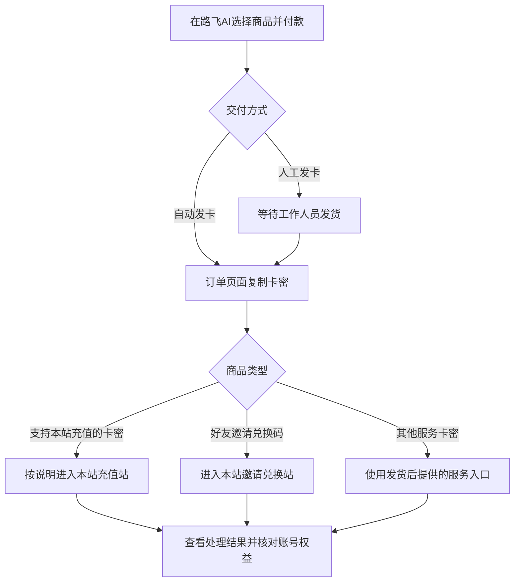

# ChatGPT Plus 充值与 Codex 额度指南：从第一次使用到额度续航

不会选套餐？付款后不知道去哪兑换？Codex 提示额度不足，却分不清该升级还是补额度？

这份中文指南按实际操作顺序讲清楚：**先选对商品，再完成兑换，最后在自己的账号里确认结果。** 不需要先学一堆术语。

维护：**路飞AI** · 内容核对日期：**2026-10-13**

**[路飞AI官网](https://lufeiai.shop/) · [充值入口](https://recharge.lufeiai.shop/) · [好友邀请资格与兑换](https://invite.lufeiai.shop/) · 路飞AI官方QQ群：`750107111`**

> 本仓库由路飞AI维护，包含本站服务介绍，具有推广性质。路飞AI是独立第三方服务站，不是 OpenAI 官方或其授权代理；“官方QQ群”指路飞AI的交流群，并非 OpenAI 官方群。

## 先看这里：你现在遇到什么问题？

| 你的问题 | 先读这篇 | 读完能做什么 |
| --- | --- | --- |
| 第一次接触，不知道该买什么 | [3 分钟分清 Plus、Codex 和额度](docs/01-start-here.md) | 区分订阅、额度、卡密和服务费用 |
| 想给自己的 ChatGPT 账号开通 Plus | [ChatGPT Plus 充值：下单到验收](docs/02-plus-recharge.md) | 核对规格、兑换，并确认到账账号 |
| 已有账号，想让 Codex 帮忙写代码 | [Codex 入门：把第一件小任务跑起来](docs/03-codex-getting-started.md) | 登录、选项目、发需求、检查结果 |
| 提示 5 小时限制或周额度不足 | [Codex 额度用完了，还要一直等重置吗？](docs/04-codex-credits.md) | 查看限制，判断是否需要额外额度 |
| 想了解好友邀请兑换 | [先查资格，再买：好友邀请兑换指南](docs/05-invite-redemption.md) | 核对带奖励次数，避免无资格购买 |
| 卡密、验证码或到账结果有疑问 | [常见问题与排查清单](docs/06-faq-and-safety.md) | 区分付款、发卡、兑换和权益到账 |

## 一、先选对，不要急着付款

你需要的可能是不同的东西：

- **订阅服务**：目标是开通或延续某个套餐，先确认账号和套餐适用条件。
- **Codex 额度**：目标是延长适用的 Codex 使用，不等同于购买 Plus，也不等同于 API 余额。
- **好友邀请兑换**：依赖账号当前活动资格，必须先检查是否有带奖励的可用邀请。
- **学生认证服务**：有单独的资格与审核要求，不是所有账号都能领取。

商品名称相似，不代表权益相同。“买一个更贵的”也不一定能解决你遇到的问题。

**价格、库存、规格和购买条件以[商城实时页面](https://lufeiai.shop/)为准。** 本指南不固定写人民币价格，避免商品调价后误导读者。

## 二、买后去哪操作？

本站当前采用以下流程。订单中的交付说明优先于教程。

**付款成功 ≠ 卡密已发货 ≠ 兑换成功 ≠ 账号权益已到账。**

这四步要分别确认。特别是人工发货商品，付款后显示“等待人工发货”是正常状态；无需反复支付。

## 三、Codex 额度：最容易搞错的三件事

1. **先看限制，再考虑补额度。** 登录问题、网络问题和权限问题不是靠充值解决的。
2. **先查邀请资格，再购买邀请服务。** 能发送邀请，不一定还有带奖励的次数。
3. **看最终到账，不只看兑换提示。** 在需要使用的账号中确认余额、有效期与订阅状态。

关于额度消耗、重置与活动规则，集中看[额度专题](docs/04-codex-credits.md)，不要把不同来源的额度当成一种余额。

## 四、账号与凭证，别发错地方

Session、Token、Cookie 等登录凭证可能让他人访问你的账号，不能当成普通截图。

- 不要发到 GitHub Issue、QQ群、客服聊天或评论区。
- 如服务确实需要凭证，先确认站点、必要性及隐私说明，只在对应操作页面提交。
- 教程截图要遮住邮箱、订单查询安全码、卡密与验证码。
- 不使用虚假学生身份，不借用他人的认证材料，不提供绕过验证的教程。

服务可用地区与账号验证要求受官方政策约束；访问第三方商城不代表符合 OpenAI 的使用条件。本指南面向中文读者，不承诺中国大陆账号或网络可直接使用所有服务。

## 五、联系我们与参与更新

**路飞AI官网：[https://lufeiai.shop/](https://lufeiai.shop/)**

**路飞AI官方QQ群：`750107111`**（在 QQ 中搜索群号；入群条件以群设置为准）

**更多教程与资讯：[AI资讯](https://lufeiai.shop/articles) · [订单查询](https://lufeiai.shop/query)**

遇到订单问题，在官网客服渠道提供打码后的订单信息。GitHub Issue 只用于教程勘误，不处理含个人资料的售后。

欢迎提交链接失效、步骤变化等勘误，先读[贡献说明](CONTRIBUTING.md)。

## 资料来源与原创说明

教程中的官方产品信息以原始文档为准，各篇附有相关链接；本站流程根据当前商城与页面说明整理。

- [OpenAI：ChatGPT 与 Codex 入门](https://learn.chatgpt.com/docs/quickstart)
- [OpenAI：Codex CLI](https://learn.chatgpt.com/docs/codex/cli)
- [OpenAI：套餐与 Codex 使用规则](https://learn.chatgpt.com/docs/pricing)

本项目在主题组织上参考了 [cabbagecabbage 的中文指南](https://github.com/cabbagecabbage/chatgpt-plus-codex-cn-guide)，正文、流程说明和排查清单独立编写，未复制其文章、截图或个人使用经历，也未获得该作者背书。

© 2026 路飞AI。欢迎分享本仓库链接；转载正文、图片或用于其他商业宣传前，请联系维护者取得许可。ChatGPT、Codex 等名称及商标归其各自权利人所有。
